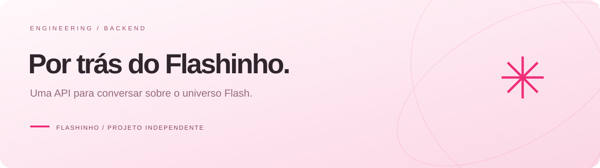
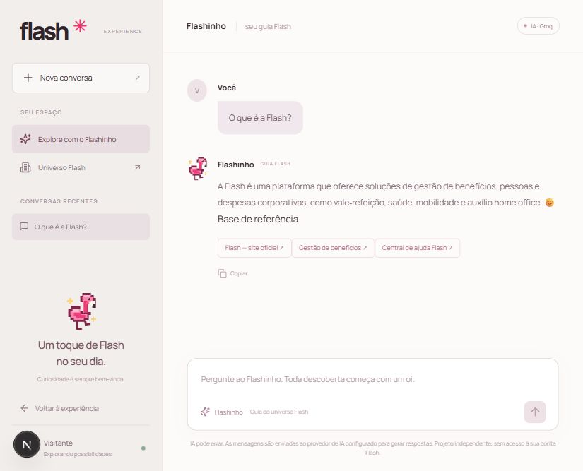
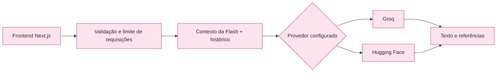
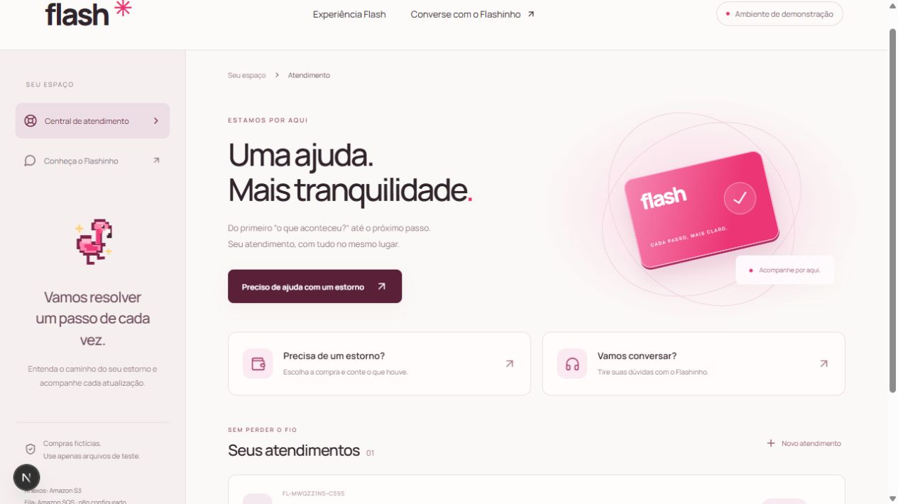

<div align="center">



# Flashinho API

O backend que recebe a pergunta, prepara o contexto e traz a resposta do Flashinho.


[Rodar localmente](#rodar-localmente) · [API](#api) · [Testes](#testes) · [Frontend](https://github.com/pedroigor-dev/flashproject)

</div>

## O que este serviço faz

O Flashinho é um assistente para conversar sobre a Flash. Esta API recebe o histórico do chat, valida as mensagens e acrescenta uma base de informações públicas antes de chamar o modelo.

A integração aceita Groq e Hugging Face. O exemplo de configuração usa **Groq com `openai/gpt-oss-120b`**. A troca de provedor acontece no backend, sem mudar o contrato com o frontend.

É um projeto independente de apresentação. Não tem acesso a contas Flash, saldos ou dados de colaboradores.

## A API em uso



Esta é a resposta exibida pelo [frontend](https://github.com/pedroigor-dev/flashproject). As credenciais ficam no servidor; o navegador recebe o texto, o modelo utilizado e os links da base de referência.

## Caminho de uma pergunta



O serviço chama somente o provedor selecionado. Não há troca automática para outro serviço nem uma resposta pronta para esconder falhas da IA. Se ocorrer um erro, o frontend pode mostrar a mensagem e oferecer uma nova tentativa.

## Rodar localmente

Requer **Node.js 22 ou superior** e uma chave do provedor escolhido.

```bash
git clone https://github.com/pedroigor-dev/flashbackend.git
cd flashbackend
npm ci
```

Copie `.env.example` para `.env`. No PowerShell:

```powershell
Copy-Item .env.example .env
```

No macOS ou Linux, use `cp .env.example .env`. Preencha a chave no arquivo local:

```dotenv
PORT=4000
AI_PROVIDER=groq
GROQ_MODEL=openai/gpt-oss-120b
GROQ_API_KEY=sua_chave_aqui
```

Depois, inicie o servidor:

```bash
npm run dev
```

A API fica em `http://127.0.0.1:4000/api`. Para testar pela interface, rode o [frontend](https://github.com/pedroigor-dev/flashproject#rodar-localmente) na porta `3200`.

O `.env` é ignorado pelo Git. Compartilhe apenas o `.env.example`, sem credenciais reais.

### Configuração dos provedores

| Variável       | Uso                                                          |
| -------------- | ------------------------------------------------------------ |
| `PORT`         | Porta da API; padrão `4000`                                  |
| `AI_PROVIDER`  | `groq` ou `huggingface`; o arquivo de exemplo seleciona Groq |
| `GROQ_API_KEY` | Chave da Groq, exigida quando esse provedor está ativo       |
| `GROQ_MODEL`   | Padrão `openai/gpt-oss-120b`                                 |
| `HF_TOKEN`     | Token de inferência da Hugging Face                          |
| `HF_MODEL`     | Padrão `openai/gpt-oss-120b:cheapest`                        |

Para Hugging Face, altere `AI_PROVIDER=huggingface` e preencha `HF_TOKEN`. Reinicie o servidor após mudar o `.env`. Se `AI_PROVIDER` for omitido, o código usa Hugging Face.

Disponibilidade, créditos e limites dependem da conta e do modelo. Consulte os [limites da Groq](https://console.groq.com/docs/rate-limits) e a [documentação da Hugging Face](https://huggingface.co/docs/inference-providers/tasks/chat-completion). O código não ativa planos pagos nem recargas automáticas.

## API

### `GET /api/health`

Informa se o serviço está ativo e se existe uma credencial configurada:

```json
{
  "status": "ok",
  "service": "flashbackend",
  "ai": {
    "provider": "groq",
    "configured": true,
    "model": "openai/gpt-oss-120b"
  }
}
```

`configured: true` indica presença da chave. Não confirma validade, saldo ou disponibilidade do provedor.

### `POST /api/chat`

```json
{
  "messages": [{ "role": "user", "content": "O que é a Flash?" }]
}
```

O histórico aceita de 1 a 20 mensagens, com até 4.000 caracteres cada. Os papéis permitidos são `user` e `assistant`; a última mensagem precisa ser do usuário. Conteúdo vazio e campos desconhecidos são rejeitados.

Exemplo de resposta, com texto ilustrativo:

```json
{
  "text": "A Flash oferece soluções de gestão de benefícios, pessoas e despesas corporativas.",
  "sources": [
    { "title": "Flash — site oficial", "url": "https://flashapp.com.br/" },
    { "title": "Gestão de benefícios", "url": "https://flashapp.com.br/gestao-de-beneficios" },
    { "title": "Central de ajuda Flash", "url": "https://faq.flashapp.com.br/" }
  ],
  "model": "openai/gpt-oss-120b",
  "provider": "groq"
}
```

As respostas chegam completas em JSON. Não há streaming de tokens nesta versão.

### Testar pelo PowerShell

```powershell
$body = @{ messages = @(@{ role = 'user'; content = 'O que é a Flash?' }) } | ConvertTo-Json -Depth 4
Invoke-RestMethod -Uri 'http://127.0.0.1:4000/api/chat' -Method Post -ContentType 'application/json; charset=utf-8' -Body ([System.Text.Encoding]::UTF8.GetBytes($body))
```

| Status | Situação                                                 |
| ------ | -------------------------------------------------------- |
| `400`  | Mensagem ou histórico inválido                           |
| `413`  | Corpo da requisição acima do limite                      |
| `429`  | Limite local ou do provedor atingido                     |
| `502`  | Falha de conexão ou resposta inválida do provedor        |
| `503`  | Configuração, credencial, créditos ou plano indisponível |
| `504`  | Tempo limite ou interrupção da resposta                  |

## Organização

```text
src/
├── main.ts                  # Bootstrap, Helmet e validação global
├── app.module.ts            # Configuração e rate limiting
└── chat/
    ├── chat.controller.ts   # Endpoints e cancelamento da chamada
    ├── chat.dto.ts          # Regras de entrada
    ├── chat.service.ts      # Provedores e tratamento de erros
    ├── knowledge.ts         # Base pública e fontes oficiais
    ├── chat-context.ts      # Instruções e contexto enviados ao modelo
    └── answer.ts            # Tratamento da resposta e referências
test/
└── chat.test.cjs             # Testes com node:test
```

NestJS organiza a API em controller e service. A configuração vem do `@nestjs/config`, os DTOs usam `class-validator` e o limite de chamadas usa `@nestjs/throttler`. O cliente HTTP é o `fetch` do Node.js.

## Testes

```bash
npm test
```

O comando compila o backend e roda sete testes com o runner do Node.js. Eles cobrem ausência de credencial, contexto enviado ao modelo, tratamento seguro de falhas, validação e limite de requisições, além da separação entre as credenciais dos provedores. As chamadas externas são simuladas nos testes; não é necessário gastar créditos.

| Comando         | Uso                              |
| --------------- | -------------------------------- |
| `npm run dev`   | Desenvolvimento com recompilação |
| `npm run build` | Compila para `dist/`             |
| `npm start`     | Executa o build                  |
| `npm test`      | Compila e executa a suíte        |

## Limites e decisões

A base em `knowledge.ts` é enviada junto com a conversa. Não há busca na web em tempo real nem recuperação vetorial de documentos. O modelo indica os IDs das fontes usadas, e o servidor converte apenas IDs conhecidos em links da base. Isso evita URLs inventadas nos cartões de referências, mas não equivale a verificar cada frase gerada. O modelo ainda pode errar.

O histórico permanece no navegador. A API não persiste conversas, não tem autenticação e não usa banco de dados. As mensagens e o histórico enviado passam pelo provedor configurado; o aplicativo não registra prompts e respostas em logs.

O servidor escuta apenas em `127.0.0.1`. Há limite de corpo de 96 KB, timeout de 45 segundos e limite de 20 requisições por minuto por IP. Como o Next.js faz o proxy, as chamadas locais compartilham esse limite. A configuração atual é para demonstração local; uma publicação multiusuário precisa de autenticação, cotas por usuário e armazenamento compartilhado do limitador.

A escolha de Node.js, TypeScript e NestJS segue tecnologias citadas nas [vagas da Flash consultadas no projeto](https://jobs.lever.co/flashapp/8ec8070d-d843-4452-a2e7-3b1290ff9f0d). MongoDB e bancos relacionais também aparecem nessas vagas, mas não foram adicionados sem uma necessidade de persistência nesta versão.

---

<div align="center">

**A conversa aparece no frontend. O cuidado com a integração fica aqui.**

[Pedro Igor](https://github.com/pedroigor-dev) · [Veja a experiência completa](https://github.com/pedroigor-dev/flashproject)

</div>

## Base de conhecimento ampliada

Revisada em 16/11/2026, a base cobre história, cultura, ética, arquitetura, migração de sistemas, práticas de engenharia, vagas, produtos, benefícios e IA. Os resumos e links oficiais estão em `src/chat/knowledge.ts`. Incluem o Código de Conduta de outubro de 2025 e relatos técnicos publicados pela própria Flash.

O conteúdo é uma fotografia das fontes consultadas, não uma pesquisa automática a cada pergunta. Para atualizar, revise a fonte original, corrija o resumo e a data de consulta e teste perguntas reais. Datas de publicação não devem ser confundidas com início de práticas. A base mantém o escopo e o período dos relatos; divergências não devem ser resolvidas por suposição.

As respostas podem desenvolver conceitos, exemplos hipotéticos e preparação para entrevistas, distinguindo-os de fatos da empresa. A suíte verifica preservação do histórico e conversão segura de referências; qualidade factual ainda exige avaliação das respostas reais.

## Formatação do código

O projeto usa Prettier e EditorConfig para manter indentação, quebras de linha e espaçamento consistentes.

```bash
npm run format
npm run format:check
```

O primeiro comando formata os arquivos; o segundo verifica o padrão sem alterá-los. Arquivos gerados, imagens e variáveis de ambiente ficam fora da formatação.

## Central de atendimento e estornos



A API agora também acompanha solicitações demonstrativas de estorno: protocolo, etapas, comprovantes privados, triagem no n8n e orientação contextual com o Flashinho. A persistência usa SQLite e outbox transacional; na AWS, os arquivos ficam no S3 e os eventos passam pelo SQS com fila de falhas. A conclusão é uma simulação acionada pelo usuário.

O fluxo completo, a configuração local e Docker, os recursos AWS e os limites desta POC estão no [guia da central](docs/support.md). É necessário Node.js 24 ou superior para esse módulo.
