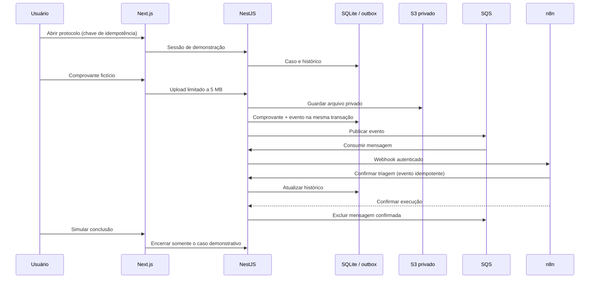

# Central de estornos

A central é uma POC independente, com compras fictícias. A aplicação registra o caso, guarda um comprovante de teste e acompanha a triagem. Não acessa contas Flash, não cancela transações e não movimenta dinheiro.

## Caminho de uma solicitação



## Rodar o backend

Use Node.js 24 ou superior, pois a persistência utiliza `node:sqlite` (API ainda experimental nessa versão). Instale as dependências e preencha `.env` a partir de `.env.example`.

```bash
npm ci
node scripts/prepare-n8n.cjs
npm run dev
```

O script gera a credencial de automação e os arquivos de importação dentro de `data/`, ignorado pelo Git. Ele reutiliza a credencial existente. Não publique `.env`, `data/` nem os arquivos gerados de credenciais.

Sem `SUPPORT_S3_BUCKET` e `SUPPORT_SQS_URL`, os arquivos ficam no disco e a outbox entrega diretamente ao n8n. Isso permite testar a jornada sem AWS. O backend informa qual modo está usando. O n8n continua sendo necessário para concluir a triagem: sua indisponibilidade mantém o evento pendente.

## n8n com Docker

A versão está fixada no `compose.yaml`. Antes de preparar a importação para Docker, configure `N8N_BACKEND_URL=http://host.docker.internal:4000` no terminal que executará `prepare-n8n.cjs`.

```bash
node scripts/prepare-n8n.cjs
docker compose run --rm n8n import:credentials --input=/imports/credentials.json
docker compose run --rm n8n import:workflow --input=/imports/workflow.json
docker compose run --rm n8n publish:workflow --id=flashinho-refund-triage
docker compose up -d
```

O editor fica em `http://localhost:5678`. Conclua a criação do proprietário diretamente no editor para acessar a interface. As portas estão limitadas ao computador local. `N8N_SECURE_COOKIE=false` atende somente ao HTTP local; uma publicação precisa de HTTPS e cookies seguros.

O workflow recebe apenas `id` do evento e `caseId`; não recebe arquivo, descrição, dados de cartão ou a credencial AWS. O Header Auth protege entrada e callback. O HTTP Request registra o encaminhamento e o Respond to Webhook devolve a confirmação. A triagem não valida a autenticidade do comprovante nem decide o estorno. O histórico de execuções bem-sucedidas, com erro e manuais está habilitado, incluindo o progresso dos nós, para acompanhar a demonstração na aba Executions. A execução do webhook também registra seus headers: mantenha o editor e o banco do n8n privados, pois podem conter a credencial de automação. Antes de compartilhar capturas ou exportações de uma execução, oculte esses headers. O workflow não recebe a credencial AWS nem o comprovante.

### Acompanhar a triagem no modo demo

Gere a versão de demonstração com `node scripts/prepare-n8n.cjs --demo`. Importe o `workflow.json` gerado e publique o workflow com os comandos acima. Se a credencial já estiver cadastrada no n8n, reutilize-a.

O modo demo insere duas esperas de quatro segundos, uma antes de registrar o encaminhamento e outra antes de enviar a confirmação ao worker. Para ver os nós mudando de cor, configure `N8N_REFUND_LIVE_DEMO=true` no `.env` do backend e reinicie-o. No **Editor** do n8n, clique em **Execute workflow** e aguarde aparecer **Waiting for trigger event**. Com o editor aberto, envie um comprovante de teste pela central em outra aba. O backend usa o webhook de teste quando o editor está escutando e o webhook publicado nos demais envios. Clique em **Execute workflow** de novo antes de repetir o teste.

A aba **Executions** mostra o histórico e o status da execução. Para voltar ao fluxo rápido, desative `N8N_REFUND_LIVE_DEMO`, reinicie o backend e publique o workflow gerado sem `--demo`.

### Alternativa local sem Docker

Para desenvolvimento, a versão 2.48.7 também pode ser executada pelo Node, embora o fornecedor esteja descontinuando esse modo. Configure `N8N_USER_FOLDER` para uma pasta privada dentro de `data/`, `N8N_LISTEN_ADDRESS=127.0.0.1`, `N8N_DIAGNOSTICS_ENABLED=false` e `N8N_SECURE_COOKIE=false`. Execute os mesmos comandos `import:credentials`, `import:workflow`, `publish:workflow` e `start` com `npx --yes --package=n8n@2.48.7 n8n`. Em produção, prefira a imagem oficial e configure os task runners externos caso use nós de código; este workflow utiliza apenas nós HTTP e Webhook.

## AWS

`infra/refunds.template.json` cria:

- Bucket S3 com acesso público bloqueado, ACLs desativadas, criptografia AES256, exigência de HTTPS e expiração de objetos após 7 dias.
- Fila SQS padrão criptografada, com visibilidade de 60 segundos.
- Fila de falhas após 5 recebimentos sem sucesso, retenção de 14 dias.
- Usuário sem acesso ao console, limitado a objetos em `refunds/*` no bucket e às operações necessárias na fila principal.

O template não contém chaves. Para uma aplicação hospedada na AWS, prefira uma role com credenciais temporárias. A chave do usuário atende ao desenvolvimento local e deve ser desativada quando deixar de ser necessária.

```bash
aws cloudformation deploy --stack-name flashinho-demo --template-file infra/refunds.template.json --capabilities CAPABILITY_NAMED_IAM --region us-east-2
aws cloudformation describe-stacks --stack-name flashinho-demo --region us-east-2 --query 'Stacks[0].Outputs'
```

Preencha o bucket e a URL da fila no `.env`, configure as credenciais e reinicie o backend. O bucket é retido se a stack for excluída; não presuma que excluir a stack apaga todos os arquivos. S3/SQS geram consumo sujeito ao plano da conta. Parar o backend interrompe o polling local da fila.

## Segurança e recuperação

A sessão de demonstração usa um segredo aleatório de 256 bits, guardado em cookie HttpOnly e SameSite Strict pelo Next.js. O banco guarda seu hash. Cada protocolo e anexo é restrito à sessão que o criou. Isso não substitui autenticação de usuários: limpar os cookies perde o acesso aos protocolos anteriores. É um ambiente para dados fictícios, não um portal pronto para clientes reais.

O proxy permite apenas as rotas previstas e verifica a origem das mutações. O backend limita uploads, confere assinatura básica e tipo de arquivo e força download como anexo. Essa validação não equivale a antivírus; arquivos de clientes reais exigiriam análise de malware, política de retenção, identidade e controles adicionais.

A criação usa `Idempotency-Key`; reutilizar a chave com conteúdo diferente retorna 409. A combinação sessão/compra também impede protocolos repetidos. O comprovante e a outbox são persistidos na mesma transação SQLite. Se o processo cair após publicar no SQS e antes de marcar o evento como publicado, poderá ocorrer entrega duplicada. O callback deduplica pelo ID do evento na mesma transação que registra o histórico.

Falhas de publicação permanecem na outbox com tentativas e espera progressiva. Falhas de consumo não excluem a mensagem do SQS. Se o n8n falhar, corrija a configuração; a fila tentará novamente. Se a mensagem chegar à DLQ, reenvie-a à fila de origem pelo console SQS após corrigir a causa. O callback só é aceito para um evento da outbox pertencente ao protocolo.

O worker pressupõe uma única instância de backend e o mesmo banco local para produção e consumo. Antes de escalar horizontalmente, migre a persistência para PostgreSQL, use leases na outbox e separe API e workers. SQLite simplifica a execução desta POC e não é apresentado como arquitetura de alta disponibilidade.

## Estados

| Estado             | Próximo passo                                          |
| ------------------ | ------------------------------------------------------ |
| `waiting_merchant` | Usuário informa o contato com o estabelecimento        |
| `waiting_receipt`  | Anexar comprovante fictício                            |
| `queued`           | Aguardar a confirmação do n8n                          |
| `reviewing`        | A triagem encaminhou o caso para análise demonstrativa |
| `completed`        | Usuário acionou a conclusão simulada                   |

`SUPPORT_DEMO_ENABLED=false` remove o encerramento simulado da interface e da API. O texto de cada evento registra o que ocorreu, sem alegar uma devolução financeira real.

## Validação

`npm test` executa testes isolados sem consumir AWS ou IA. Cobre autorização por sessão, idempotência, transições inválidas, callback duplicado, confirmação do worker e validação de arquivos. A execução de ponta a ponta com serviços reais é feita separadamente com arquivos fictícios. A referência funcional é o [guia público de estornos da Flash](https://faq.flashapp.com.br/kb/guide/pt-BR/como-funciona-o-estorno-e-o-que-fazer-em-caso-de-cobranca-duplicada-YCKtRTryEC/Steps/4198154), consultado em 21/11/2026.

### Teste com os serviços reais

Com backend, AWS e workflow n8n em execução, rode `npm run test:integration`. O teste cria uma sessão e um atendimento fictícios, verifica a idempotência, envia o PDF de teste ao S3, baixa por link assinado, aguarda SQS/n8n, encerra a simulação e tenta acessar o anexo por outra sessão. Ele consome serviços AWS e deixa o protocolo de teste no banco; o arquivo é removido pelo ciclo de vida do bucket. Não faz parte de `npm test`.

### Acompanhar a automação

Abra o workflow Flashinho - Triagem de estornos e selecione **Executions**. Deixe **Auto refresh** ativado, se a opção estiver disponível. Ao enviar um comprovante pela central, o SQS dispara o processamento e uma nova execução aparece nessa lista. Selecione-a para inspecionar os três nós. A confirmação esperada é `processed: true`, com o ID do evento. Não use Execute workflow para o fluxo normal do site: esse botão inicia o listener de teste, enquanto o backend chama o webhook publicado. Execuções anteriores à habilitação do histórico não ganham dados retroativamente.
